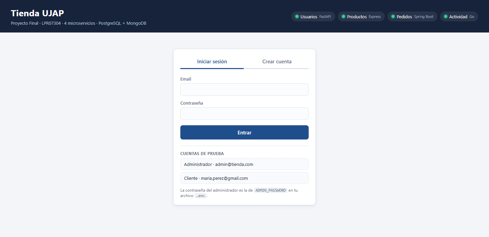
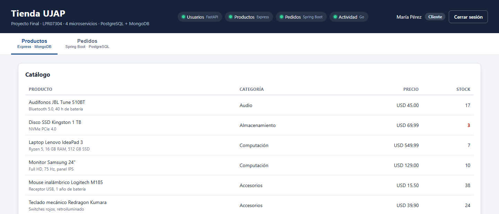
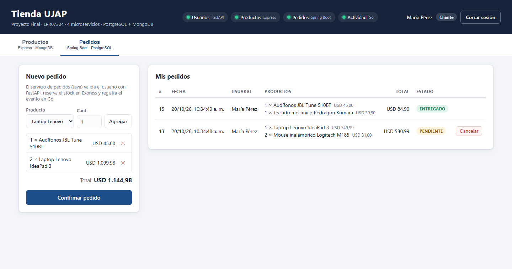
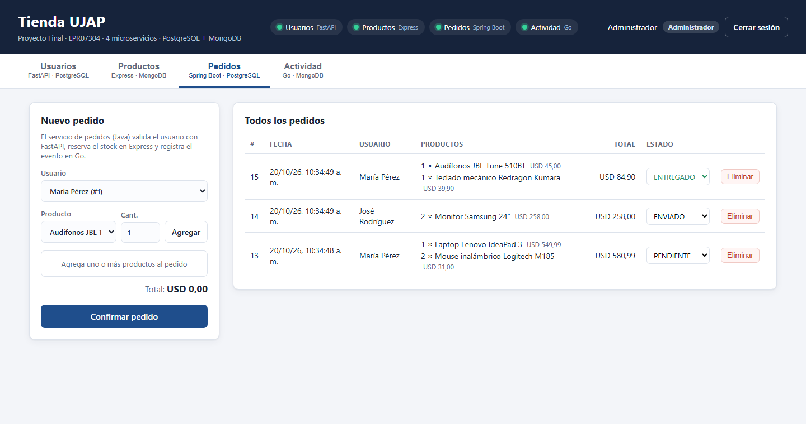
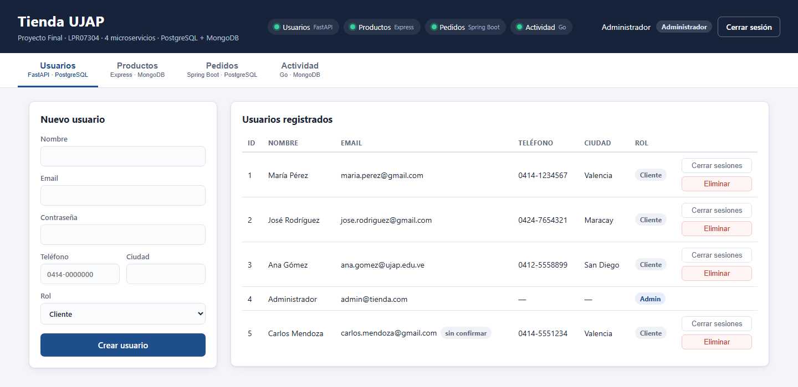
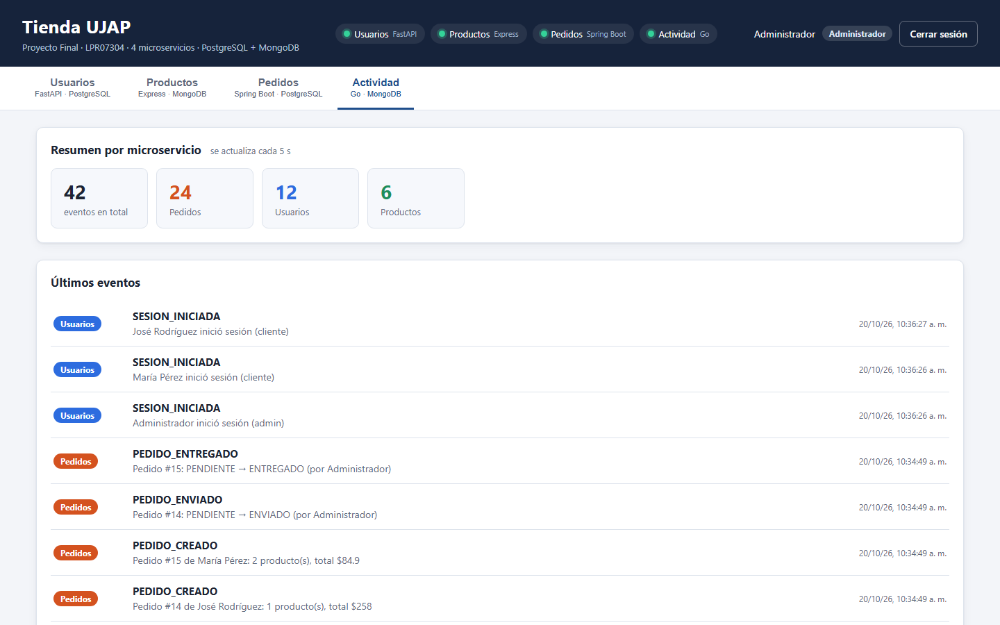
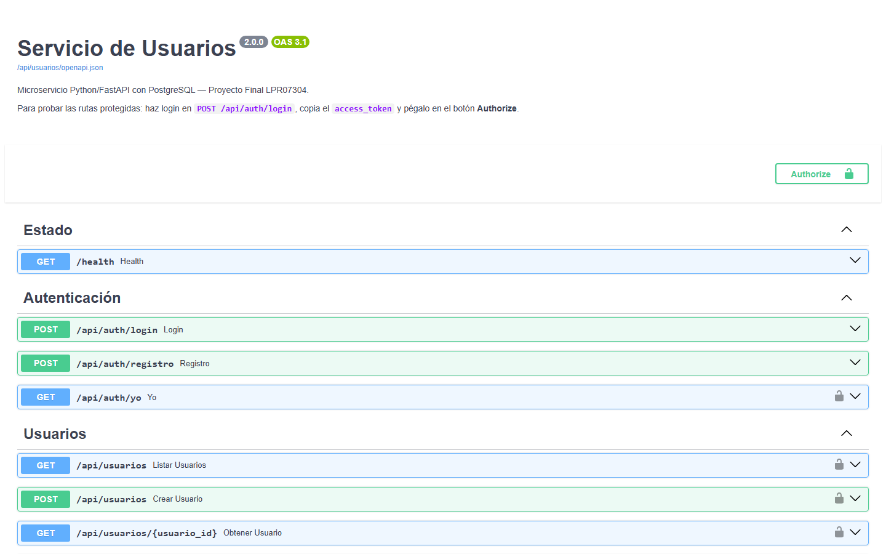
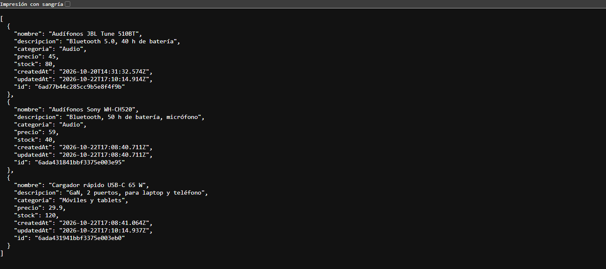

# Tienda UJAP — Sistema de pedidos con microservicios

Proyecto Final · **LPR07304 Lenguajes de Programación** · Universidad José Antonio Páez

## ¿Qué hace el sistema?

**Tienda UJAP** es una tienda en línea de productos de computación y tecnología:

- **Los clientes** crean su cuenta, consultan el catálogo con precios y disponibilidad, arman pedidos con uno o varios productos y siguen su estado. Pueden cancelar un pedido mientras esté pendiente.
- **El administrador** gestiona usuarios y catálogo, ve todos los pedidos, cambia su estado y consulta un **historial de actividad** de todo lo que ocurre en el sistema.

Al confirmar un pedido, el sistema verifica que el cliente existe, **reserva el stock** de cada producto (sin vender nunca más de lo que hay, aunque varias personas compren a la vez) y registra el evento. Si hay que devolver stock, se devuelve exactamente una vez.

Cada parte del sistema es un **microservicio escrito en un lenguaje distinto**, con su propio contenedor Docker, y todo se levanta con **un solo comando**.

## Capturas

| Inicio de sesión | Catálogo (vista de cliente) |
|---|---|
|  |  |

| Pedido con varios productos (cliente) | Todos los pedidos (administrador) |
|---|---|
|  |  |

| Usuarios (administrador) | Actividad en tiempo real (administrador) |
|---|---|
|  |  |

**Servicios respondiendo** — Swagger del servicio de usuarios (FastAPI) y respuesta JSON del servicio de productos (Express):

| Swagger — usuarios | API — productos |
|---|---|
|  |  |

## Arquitectura

```
                                     Navegador
                                         │
                                         ▼  http://tienda.ujap.test
                          ┌──────────────────────────────┐
                          │     API Gateway (Nginx)      │   ← único puerto publicado (80)
                          └──────────────────────────────┘
          │                 │                 │                 │                 │
          ▼ /               ▼ /api/usuarios   ▼ /api/pedidos    ▼ /api/productos  ▼ /api/eventos
   ┌────────────┐   ┌──────────────┐  ┌──────────────┐  ┌──────────────┐  ┌──────────────┐
   │  frontend  │   │   usuarios   │  │   pedidos    │  │  productos   │  │  actividad   │
   │ HTML / JS  │   │Python FastAPI│  │ Java Spring  │  │ Node Express │  │      Go      │
   │  (Nginx)   │   │ + login/JWT  │  │              │  │              │  │              │
   └────────────┘   └──────┬───────┘  └──────┬───────┘  └──────┬───────┘  └──────┬───────┘
                           │                 │                 │                 │
                           └────────┬────────┘                 └────────┬────────┘
                                    ▼                                   ▼
                             ┌────────────┐                      ┌────────────┐
                             │ PostgreSQL │                      │  MongoDB   │
                             │   (SQL)    │                      │  (NoSQL)   │
                             └────────────┘                      └────────────┘
```

Cuatro microservicios, **dos por cada base de datos**:

| Base de datos | Microservicio | Lenguaje / Framework |
|---|---|---|
| PostgreSQL 16 | `servicio-usuarios` — usuarios y login con JWT | Python 3.12 + FastAPI + SQLAlchemy |
| PostgreSQL 16 | `servicio-pedidos` — pedidos con varios productos | Java 21 + Spring Boot + Spring Data JPA |
| MongoDB 7 | `servicio-productos` — catálogo y stock | Node.js 22 + Express 5 + Mongoose |
| MongoDB 7 | `servicio-actividad` — historial de eventos | Go 1.25 + net/http + mongo-driver |

## Las 6 partes del repositorio

El repositorio se publicó por partes, ordenadas según sus dependencias: el servicio de pedidos usa a los otros tres, por eso va después de ellos. Cada parte deja un sistema coherente y probado.

| # | Parte | Contenido | Estado |
|:-:|---|---|:-:|
| 1 | Infraestructura base | `docker-compose.yml` con PostgreSQL y MongoDB, API Gateway (Nginx), variables de entorno y nombre local `tienda.ujap.test` | ✅ |
| 2 | Servicio de usuarios y autenticación | `servicio-usuarios/` — Python · FastAPI · PostgreSQL: registro, login, roles y tokens JWT | ✅ |
| 3 | Servicio de productos | `servicio-productos/` — Node.js · Express · MongoDB: catálogo y stock | ✅ |
| 4 | Servicio de actividad | `servicio-actividad/` — Go · MongoDB: historial de eventos del sistema | ✅ |
| 5 | Servicio de pedidos | `servicio-pedidos/` — Java · Spring Boot · PostgreSQL: pedidos con varios productos | ✅ |
| 6 | Frontend, pruebas y documentación | `frontend/`, `tests/`, `docs/capturas/`, `docker-compose.debug.yml` y este README | ✅ |

## Contenido del repositorio

```
.
├── docker-compose.yml        ← orquesta los 8 contenedores
├── docker-compose.debug.yml  ← (opcional) publica los puertos de cada microservicio
├── .env.example              ← plantilla de variables de entorno
├── .gitignore
├── .gitattributes
├── configurar-dominio.ps1    ← agrega tienda.ujap.test al archivo hosts (Windows)
├── README.md
├── docs/capturas/            ← capturas de pantalla
├── tests/e2e.py              ← pruebas de extremo a extremo
├── gateway/
│   ├── Dockerfile
│   └── nginx.conf            ← rutas hacia cada microservicio
├── frontend/                 ← parte 6
│   ├── Dockerfile
│   ├── index.html
│   ├── style.css
│   └── app.js
├── servicio-usuarios/        ← parte 2
│   ├── Dockerfile
│   ├── requirements.txt
│   └── app/
│       ├── main.py           ← rutas de autenticación y de usuarios
│       ├── seguridad.py      ← bcrypt, tokens JWT y permisos por rol
│       ├── models.py         ← tabla `usuarios` (SQLAlchemy)
│       ├── schemas.py        ← validación de datos (Pydantic)
│       ├── database.py       ← conexión a PostgreSQL
│       └── actividad.py      ← envío de eventos al servicio de actividad
├── servicio-productos/       ← parte 3
│   ├── Dockerfile
│   ├── package.json / package-lock.json
│   └── src/
│       ├── index.js              ← arranque, conexión a MongoDB y manejo de errores
│       ├── productos.routes.js   ← rutas del catálogo y del stock
│       ├── producto.model.js     ← colección `productos` (Mongoose)
│       ├── auth.js               ← verificación de tokens JWT y permisos por rol
│       ├── actividad.js          ← envío de eventos al servicio de actividad
│       └── seed.js               ← productos de ejemplo
├── servicio-actividad/       ← parte 4
│   ├── Dockerfile            ← compilación en dos etapas: la imagen final solo lleva el binario
│   ├── go.mod / go.sum
│   └── main.go               ← servidor HTTP, verificación de JWT y acceso a MongoDB
└── servicio-pedidos/         ← parte 5
    ├── Dockerfile            ← compilación con Maven en dos etapas: la imagen final solo lleva el JRE
    ├── pom.xml
    └── src/main/
        ├── resources/application.properties
        └── java/ve/edu/ujap/pedidos/
            ├── modelo/         ← Pedido, PedidoItem y EstadoPedido (entidades JPA)
            ├── repositorio/    ← PedidoRepository (Spring Data)
            ├── servicio/       ← PedidoService (reglas de negocio) y RecuperacionPedidos
            ├── integracion/    ← llamadas HTTP a usuarios, productos y actividad
            ├── seguridad/      ← verificación y firma de tokens JWT
            ├── dto/            ← cuerpos de las peticiones, con validaciones
            └── web/            ← controladores REST y manejo de errores
```

## Cómo ejecutarlo

**Requisito:** Docker Desktop (o Docker Engine + Compose v2).

```bash
git clone <url-del-repositorio>
cd <carpeta-del-repositorio>
cp .env.example .env            # en Windows: copy .env.example .env
docker compose up --build
```

La primera vez tarda varios minutos (se descargan imágenes y se compilan los servicios, sobre todo el de Java). Con `docker compose up -d --build` se levanta en segundo plano; `docker compose ps` debe mostrar `postgres`, `mongodb` y los cuatro microservicios en estado `healthy`, y `frontend` y `gateway` en `running`. El servicio de pedidos es el último en estar listo.

### Abrir el sistema

El sistema se abre en **http://tienda.ujap.test**. Ese nombre solo existe en tu equipo: hay que agregarlo al archivo `hosts` **una sola vez**, indicando que apunta a tu propia máquina (`127.0.0.1`):

- **Windows:** clic derecho en `configurar-dominio.ps1` → *Ejecutar con PowerShell* (pide permiso de administrador).
- **Linux / macOS:** `echo "127.0.0.1 tienda.ujap.test" | sudo tee -a /etc/hosts`

Después abre http://tienda.ujap.test en el navegador. Todos los ejemplos de este documento usan esa dirección.

Si el puerto 80 de tu equipo está ocupado, cambia `GATEWAY_PORT` en `.env` (por ejemplo, `8080`) y abre `http://tienda.ujap.test:8080` (y usa ese puerto en los ejemplos).

> **Alternativa sin tocar `hosts`:** el gateway también responde en `http://localhost`, pero la dirección oficial del proyecto es `tienda.ujap.test`.

| Qué | Dirección |
|---|---|
| **Aplicación** | http://tienda.ujap.test |
| Swagger del servicio de usuarios | http://tienda.ujap.test/api/usuarios/docs |
| Catálogo (JSON, público) | http://tienda.ujap.test/api/productos |

### Cuentas de demostración

Se crean al iniciar por primera vez, junto con **28 productos** de ejemplo en 8 categorías (con stock de 12 a 200 unidades):

| Rol | Email | Contraseña |
|---|---|---|
| Administrador | el de `ADMIN_EMAIL` (por defecto `admin@tienda.com`) | el de `ADMIN_PASSWORD` de tu `.env` |
| Cliente | `maria.perez@gmail.com`, `jose.rodriguez@gmail.com`, `ana.gomez@ujap.edu.ve` | `Cliente2026` |

En la pantalla de inicio de sesión, los botones de *Cuentas de prueba* rellenan el formulario (la del administrador solo el email: la contraseña es la de tu `.env`).

### Comandos útiles

```bash
docker compose ps                         # estado de los contenedores (healthy / starting)
docker compose logs -f servicio-pedidos   # ver los registros de un servicio
docker compose down                       # detener todo (los datos se conservan)
docker compose down -v                    # detener y BORRAR los datos (vuelve a cargar los de ejemplo)
```

## Parte 1 — Infraestructura base

### Bases de datos

| Servicio | Imagen | Datos | Comprobación de estado |
|---|---|---|---|
| `postgres` | `postgres:16-alpine` | volumen `pgdata` | `pg_isready` |
| `mongodb` | `mongo:7` | volumen `mongodata` | `ping` con `mongosh` |

Los datos se conservan entre reinicios gracias a los volúmenes.

### API Gateway

Nginx es el único punto de entrada. El frontend y los microservicios no se publican directamente; el gateway reparte las peticiones por ruta:

| Ruta | Destino |
|---|---|
| `/api/auth/*`, `/api/usuarios/*` | `servicio-usuarios` (puerto interno 8000) |
| `/api/productos/*` | `servicio-productos` (3000) |
| `/api/pedidos/*` | `servicio-pedidos` (8080) |
| `/api/eventos/*` | `servicio-actividad` (8080) |
| `/estado/<servicio>` | endpoint `/health` de cada servicio |
| `/` | frontend |

Los endpoints que solo deben usarse entre microservicios (`/api/productos/{id}/reservar`, `/api/productos/{id}/liberar` y `POST /api/eventos`) están **bloqueados desde fuera** (responden `403`).

El gateway resuelve los nombres de los servicios en cada petición, así que arranca aunque alguno todavía no esté disponible.

## Parte 2 — Servicio de usuarios y autenticación

Microservicio en **Python 3.12 + FastAPI + SQLAlchemy 2** que guarda los usuarios en **PostgreSQL**. Cumple dos funciones: administrar usuarios y **autenticar** (inicio de sesión y emisión de tokens).

- Las contraseñas se guardan cifradas con **bcrypt**; nunca en texto plano. Un email inexistente y una contraseña incorrecta devuelven el mismo mensaje.
- Al iniciar sesión se emite un **token JWT** (HS256) que expira a los `JWT_EXPIRA_MIN` minutos (60 por defecto). Los demás microservicios verifican ese token con el mismo `JWT_SECRET`, sin consultar a este servicio en cada petición.
- Hay dos roles: **cliente** y **administrador**. Quien crea su propia cuenta siempre queda como cliente.
- La tabla `usuarios` la crea el propio servicio al arrancar, con reintentos hasta que PostgreSQL esté listo.
- Cada acción importante (inicio de sesión, registro, alta, cambio y baja de usuarios) se envía como evento al servicio de actividad. Si ese servicio no está disponible, deja un aviso en el log y sigue funcionando.

### Permisos

| Acción | Sin sesión | Cliente | Administrador |
|---|:-:|:-:|:-:|
| Crear cuenta e iniciar sesión | ✅ | | |
| Ver y editar sus propios datos | | ✅ | ✅ |
| Ver a cualquier usuario, listar, crear y eliminar usuarios | | | ✅ |
| Cambiar el rol de un usuario | | | ✅ |

### Endpoints

Las rutas marcadas con 🔒 requieren `Authorization: Bearer <token>`. Los errores siempre tienen el formato `{"detail": "mensaje"}`.

| Método | Ruta | Quién | Descripción |
|---|---|---|---|
| POST | `/api/auth/registro` | público | Crear cuenta de cliente → devuelve el token |
| POST | `/api/auth/login` | público | `{email, password}` → `{access_token, usuario}` |
| GET | `/api/auth/yo` | 🔒 | Datos del usuario del token |
| GET | `/api/usuarios` | 🔒 admin | Listar usuarios |
| GET | `/api/usuarios/{id}` | 🔒 admin o el propio usuario | Obtener un usuario |
| POST | `/api/usuarios` | 🔒 admin | Crear usuario (con rol) |
| PUT | `/api/usuarios/{id}` | 🔒 admin o el propio usuario | Actualizar (solo el admin cambia roles) |
| DELETE | `/api/usuarios/{id}` | 🔒 admin | Eliminar (no puede eliminarse a sí mismo) |
| GET | `/health` | público | Estado del servicio (el gateway lo publica como `/estado/usuarios`) |

La contraseña debe tener entre 8 y 72 caracteres. Un email repetido responde `409` y los datos inválidos `422`.

La documentación interactiva (Swagger) está en **`/api/usuarios/docs`**: haz login, copia el `access_token` y pégalo en el botón *Authorize*.

### Cuentas de demostración del servicio

La primera vez que arranca el servicio (con la tabla vacía) se crean los tres clientes de ejemplo. El administrador se crea si no existe ninguno, con las variables `ADMIN_EMAIL` y `ADMIN_PASSWORD` de tu `.env`.

## Parte 3 — Servicio de productos

Microservicio en **Node.js 22 + Express 5 + Mongoose 8** que guarda el catálogo en **MongoDB** (colección `productos`).

- **Verifica los tokens JWT** que emite el servicio de usuarios, con el mismo `JWT_SECRET`, sin consultarle nada. El catálogo se puede **leer sin iniciar sesión**; para modificarlo hay que ser administrador.
- La primera vez que arranca, con la colección vacía, carga **28 productos de ejemplo** en 8 categorías (computación, accesorios, audio, almacenamiento, redes, impresión, gaming, móviles y tablets), con stock de 12 a 200 unidades. Si ya hay productos, no toca nada.
- **Validación:** el precio no puede ser negativo y el stock debe ser un entero mayor o igual que 0 (`400`). Un id con formato inválido responde `404`. La búsqueda `?q=` no distingue mayúsculas y escapa los caracteres especiales.
- Cada alta, cambio y baja de producto se envía como evento al servicio de actividad. Si ese servicio no está disponible, deja un aviso en el log y sigue funcionando.
- Arranca con reintentos hasta que MongoDB esté disponible, y la imagen corre con un usuario sin privilegios (`node`).

### Stock a prueba de fallos

Los endpoints `reservar` y `liberar` son para uso **interno**: solo aceptan un token de *servicio* (el que firma el servicio de pedidos) y el gateway los bloquea desde fuera.

- **Sin sobreventa:** comprobar que hay stock suficiente y descontarlo ocurre en **una sola operación atómica** sobre el documento. Con varias compras simultáneas nunca se vende más de lo que hay.
- **Idempotentes:** cada operación lleva una `referencia` única (por ejemplo, `pedido-12-<producto>`). Si la misma reserva se repite por un reintento o un *timeout*, el stock no se descuenta dos veces.
- **Liberar es seguro:** solo devuelve stock de una reserva que realmente se aplicó, y nunca dos veces.
- Las referencias ya usadas se guardan en un campo interno (`movimientos`) que no aparece en las respuestas de la API.

### Permisos

| Acción | Sin sesión | Cliente | Administrador | Otro microservicio |
|---|:-:|:-:|:-:|:-:|
| Ver el catálogo y buscar | ✅ | ✅ | ✅ | ✅ |
| Crear, modificar y eliminar productos | | | ✅ | |
| Reservar y liberar stock | | | | ✅ |

### Endpoints

| Método | Ruta | Quién | Descripción |
|---|---|---|---|
| GET | `/api/productos?q=&categoria=` | público | Catálogo, con búsqueda por nombre y filtro por categoría |
| GET | `/api/productos/{id}` | público | Un producto |
| POST | `/api/productos` | 🔒 admin | Crear `{nombre, precio, stock, categoria?, descripcion?}` |
| PUT | `/api/productos/{id}` | 🔒 admin | Actualizar |
| DELETE | `/api/productos/{id}` | 🔒 admin | Eliminar |
| POST | `/api/productos/{id}/reservar` | 🔒 servicio (interno) | `{cantidad, referencia}` descuenta stock; `409` si no alcanza |
| POST | `/api/productos/{id}/liberar` | 🔒 servicio (interno) | `{cantidad, referencia}` devuelve stock reservado |
| GET | `/health` | público | Estado del servicio (el gateway lo publica como `/estado/productos`) |

## Parte 4 — Servicio de actividad

Microservicio en **Go 1.25** (solo la biblioteca estándar `net/http` más el driver oficial de MongoDB y una biblioteca de JWT) que guarda en **MongoDB** (colección `eventos`) el historial de todo lo que ocurre en el sistema.

- Los demás microservicios le **envían un evento** por cada acción importante. Cada evento tiene `servicio`, `tipo`, `mensaje`, `datos` opcionales y la `fecha` (que pone el servidor).
- **Solo el administrador puede consultar** el historial; **solo otros microservicios pueden registrar** eventos. Verifica los tokens JWT con el mismo `JWT_SECRET` (`401` si falta o es inválido o expiró, `403` si el rol no corresponde).
- El resumen usa una **agregación de MongoDB** (`$group`) para contar los eventos por microservicio.
- **Dependencia opcional:** si este servicio no está disponible, los demás siguen funcionando; solo se pierde ese registro y dejan un aviso en su log.
- Se compila en **dos etapas**: la imagen final solo contiene el binario y corre con un usuario sin privilegios (`nobody`).
- Reintenta la conexión a MongoDB hasta que esté listo y registra cada petición en el log (salvo `/health`).

Eventos que generan los servicios:

| Servicio | Tipos de evento |
|---|---|
| `usuarios` | `SESION_INICIADA`, `USUARIO_REGISTRADO`, `USUARIO_CREADO`, `USUARIO_ACTUALIZADO`, `USUARIO_ELIMINADO` |
| `productos` | `PRODUCTO_CREADO`, `PRODUCTO_ACTUALIZADO`, `PRODUCTO_ELIMINADO` |
| `pedidos` | `PEDIDO_CREADO`, `PEDIDO_ENVIADO`, `PEDIDO_ENTREGADO`, `PEDIDO_CANCELADO`, `PEDIDO_ELIMINADO`, `PEDIDO_RECHAZADO` |

### Permisos

| Acción | Sin sesión | Cliente | Administrador | Otro microservicio |
|---|:-:|:-:|:-:|:-:|
| Consultar eventos y resumen | | | ✅ | |
| Registrar un evento | | | | ✅ |

### Endpoints

| Método | Ruta | Quién | Descripción |
|---|---|---|---|
| GET | `/api/eventos?servicio=&limite=` | 🔒 admin | Últimos eventos, del más reciente al más antiguo (`limite` entre 1 y 500, por defecto 50) |
| GET | `/api/eventos/resumen` | 🔒 admin | `{total, por_servicio: [{servicio, total}]}` |
| POST | `/api/eventos` | 🔒 servicio (interno) | `{servicio, tipo, mensaje, datos?}` → `201`; `400` si falta alguno de los tres primeros |
| GET | `/health` | público | Estado del servicio (el gateway lo publica como `/estado/actividad`) |

## Parte 5 — Servicio de pedidos

Microservicio en **Java 21 + Spring Boot 3.5 + Spring Data JPA** que guarda los pedidos en **PostgreSQL** (tablas `pedidos` y `pedido_items`). Es el que **coordina a los otros tres**.

### Cómo se crea un pedido

```
Cliente ── POST /api/pedidos (token del cliente) ──▶ pedidos (Java)
   1. GET  /api/usuarios/{id}             ──▶ usuarios (Python)   ¿existe el usuario?
   2. GET  /api/productos/{id}            ──▶ productos (Node)    nombre y precio de cada producto
   3. guarda el pedido como PROCESANDO en PostgreSQL
   4. POST /api/productos/{id}/reservar   ──▶ productos (Node)    reserva el stock de cada producto
   5. pasa el pedido a PENDIENTE
   6. POST /api/eventos                   ──▶ actividad (Go)      registra el evento
```

- Un pedido puede tener **varios productos** (hasta 20 distintos, de 1 a 1000 unidades cada uno). Si el mismo producto aparece repetido, se suman las cantidades.
- Guarda una **copia del nombre del usuario, de los productos y del precio del momento**: el historial no cambia si luego cambia el precio y se puede consultar aunque otro servicio esté caído.
- Las llamadas a los otros servicios llevan un **token JWT de servicio** de corta duración (5 minutos) y tienen tiempos de espera (3 s para conectar y 5 s para leer). Si un servicio no responde, el pedido se rechaza con `503` y un mensaje claro.
- El evento a actividad se envía en segundo plano: si ese servicio falla, el pedido igual se procesa.

### Stock a prueba de fallos

- **Reservas idempotentes:** cada reserva lleva la referencia `pedido-<id>-<producto>`, así que un reintento no descuenta dos veces.
- **Compensación:** si un pedido de varios productos falla en el segundo (por ejemplo, sin stock), se libera lo que ya se había reservado del primero y el pedido se descarta.
- **Recuperación automática:** si el servicio se cae a mitad de un pedido, este queda como `PROCESANDO`. Una tarea periódica (cada 30 s) busca los pedidos que llevan más de 60 s en ese estado, devuelve su stock y los marca `RECHAZADO`.
- **Cancelar devuelve el stock una sola vez.** Eliminar un pedido `PENDIENTE` también lo devuelve.

### Estados de un pedido

`PROCESANDO` (interno, mientras se reserva el stock) → `PENDIENTE` → `ENVIADO` → `ENTREGADO`. También puede terminar en `CANCELADO` o `RECHAZADO` (no se pudo completar).

- `CANCELADO` y `RECHAZADO` son definitivos; un pedido `ENTREGADO` no se puede cancelar.
- `PROCESANDO` y `RECHAZADO` no se pueden asignar a mano.

### Permisos

| Acción | Sin sesión | Cliente | Administrador |
|---|:-:|:-:|:-:|
| Crear un pedido | | ✅ a su nombre | ✅ para cualquier usuario |
| Ver pedidos | | ✅ solo los suyos | ✅ todos |
| Cancelar un pedido | | ✅ solo los suyos y `PENDIENTE` | ✅ |
| Cambiar el estado a `ENVIADO` o `ENTREGADO` | | | ✅ |
| Eliminar un pedido | | | ✅ |

Un cliente que pide el pedido de otra persona recibe `404`, para no revelar que existe.

### Endpoints

Todas las rutas requieren `Authorization: Bearer <token>`. Los errores tienen el formato `{"detail": "mensaje"}`: `400` datos inválidos, `401` sin token o inválido, `403` sin permiso, `404` no existe, `409` conflicto (por ejemplo, stock insuficiente), `503` otro servicio no disponible.

| Método | Ruta | Quién | Descripción |
|---|---|---|---|
| GET | `/api/pedidos?usuarioId=` | 🔒 | Cliente: sus pedidos · Admin: todos (opcionalmente los de un usuario) |
| GET | `/api/pedidos/{id}` | 🔒 | Un pedido (el cliente solo los suyos) |
| POST | `/api/pedidos` | 🔒 | `{"items": [{"productoId": "...", "cantidad": 2}]}`; el admin agrega `usuarioId` |
| PATCH | `/api/pedidos/{id}/estado` | 🔒 | `{"estado": "CANCELADO"}`; el cliente solo puede cancelar |
| DELETE | `/api/pedidos/{id}` | 🔒 admin | Eliminar |
| GET | `/health` | público | Estado del servicio (el gateway lo publica como `/estado/pedidos`) |

## Parte 6 — Frontend, pruebas y documentación

### Frontend

Interfaz web en **HTML, CSS y JavaScript sin frameworks**, servida por Nginx. Solo habla con el gateway, así que no hay problemas de CORS.

- **Inicio de sesión y registro** con el servicio de usuarios. La sesión es el token JWT, guardado en `sessionStorage` (se pierde al cerrar la pestaña). Cuando el token expira, vuelve al inicio de sesión con un aviso.
- **Vistas según el rol:** el administrador ve *Usuarios*, *Productos*, *Pedidos* y *Actividad*; el cliente, *Productos* y *Pedidos*.
- **Pedidos con carrito:** se agregan varios productos y se confirman de una vez. El cliente cancela sus pedidos pendientes; el administrador cambia el estado y elige el usuario del pedido.
- La cabecera muestra el **estado de cada microservicio** (se consulta cada 10 s) y la vista de *Actividad* se actualiza cada 5 s.
- Las acciones que no se pueden deshacer (eliminar o cancelar) piden confirmación con un **cuadro de diálogo propio**: se cierra con *Escape* o haciendo clic fuera, y el foco empieza en la opción segura.
- Se puede abrir una vista directamente, por ejemplo `http://tienda.ujap.test/#pedidos`.
- Todo el texto que llega de la API se escapa antes de mostrarlo, para evitar inyección de HTML.

### Pruebas automáticas

`tests/e2e.py` prueba el sistema completo **a través del gateway**, igual que lo usaría el frontend. Solo necesita Python 3.10 o superior (sin instalar nada) y el sistema levantado:

```bash
python tests/e2e.py                        # contra http://tienda.ujap.test
python tests/e2e.py http://localhost       # otra dirección, si no agregaste el nombre a hosts
```

Cubre **77 comprobaciones**:

- Estado de los servicios, frontend y que los puertos internos (8001 a 8004) estén cerrados.
- Inicio de sesión, registro y tokens alterados.
- Permisos de cada rol y bloqueo de los endpoints internos.
- CRUD de los 4 servicios.
- Pedidos con varios productos y compensación del stock cuando falla uno.
- Cancelaciones (el stock se devuelve una sola vez) y 8 compras simultáneas.
- Eventos en el servicio de actividad.

Lee `ADMIN_EMAIL` y `ADMIN_PASSWORD` de tu `.env` (o usa los valores por defecto) y, al terminar, **borra los datos que creó**. Como comprueba que los puertos internos estén cerrados, no debe ejecutarse con el modo de depuración activo.

### Modo depuración

Para llamar directamente a cada microservicio, `docker-compose.debug.yml` publica sus puertos (8001 usuarios, 8002 productos, 8003 pedidos, 8004 actividad):

```bash
docker compose -f docker-compose.yml -f docker-compose.debug.yml up -d
```

En uso normal **no** se usa: todo el tráfico entra por el gateway.

## Probar la API con curl

Reemplaza `<token>`, `<token-admin>`, `<id1>`, `<id2>` e `<id-pedido>` por los valores que obtengas.

Autenticación (parte 2):

```bash
# 1. Iniciar sesión como cliente de demostración → devuelve el access_token
curl -s -X POST http://tienda.ujap.test/api/auth/login -H "Content-Type: application/json" \
     -d '{"email": "maria.perez@gmail.com", "password": "Cliente2026"}'

# 2. Con ese token: tus datos
curl -s http://tienda.ujap.test/api/auth/yo -H "Authorization: Bearer <token>"

# 3. Un cliente no puede listar usuarios → 403
curl -s -i http://tienda.ujap.test/api/usuarios -H "Authorization: Bearer <token>"
```

Catálogo (parte 3):

```bash
# El catálogo es público (no necesita token)
curl -s http://tienda.ujap.test/api/productos
curl -s "http://tienda.ujap.test/api/productos?q=laptop"

# Crear un producto sin token → 401
curl -s -i -X POST http://tienda.ujap.test/api/productos -H "Content-Type: application/json" \
     -d '{"nombre": "Webcam Logitech C920", "precio": 59.9, "stock": 10}'

# Con el token del administrador (inicia sesión con ADMIN_EMAIL y ADMIN_PASSWORD de tu .env) → 201
curl -s -X POST http://tienda.ujap.test/api/productos -H "Authorization: Bearer <token-admin>" \
     -H "Content-Type: application/json" \
     -d '{"nombre": "Webcam Logitech C920", "precio": 59.9, "stock": 10, "categoria": "Accesorios"}'

# Los endpoints internos están bloqueados desde fuera → 403
curl -s -i -X POST http://tienda.ujap.test/api/productos/<id1>/reservar
```

Pedidos (parte 5), con el token del cliente y dos `id` del catálogo:

```bash
# Crear un pedido con dos productos → 201, estado PENDIENTE
curl -s -X POST http://tienda.ujap.test/api/pedidos -H "Authorization: Bearer <token>" \
     -H "Content-Type: application/json" \
     -d '{"items": [{"productoId": "<id1>", "cantidad": 2}, {"productoId": "<id2>", "cantidad": 1}]}'

# El stock bajó en el catálogo
curl -s http://tienda.ujap.test/api/productos

# Mis pedidos
curl -s http://tienda.ujap.test/api/pedidos -H "Authorization: Bearer <token>"

# Pedir más de lo que hay (500 unidades) → 409 y no queda nada reservado a medias
curl -s -i -X POST http://tienda.ujap.test/api/pedidos -H "Authorization: Bearer <token>" \
     -H "Content-Type: application/json" -d '{"items": [{"productoId": "<id1>", "cantidad": 500}]}'

# Cancelar el pedido → el stock vuelve al catálogo
curl -s -X PATCH http://tienda.ujap.test/api/pedidos/<id-pedido>/estado -H "Authorization: Bearer <token>" \
     -H "Content-Type: application/json" -d '{"estado": "CANCELADO"}'

# El administrador ve todos los pedidos y cambia su estado
curl -s http://tienda.ujap.test/api/pedidos -H "Authorization: Bearer <token-admin>"
curl -s -X PATCH http://tienda.ujap.test/api/pedidos/<id-pedido>/estado -H "Authorization: Bearer <token-admin>" \
     -H "Content-Type: application/json" -d '{"estado": "ENVIADO"}'
```

Historial de actividad (parte 4):

```bash
# El administrador consulta los últimos eventos y el resumen por servicio
curl -s "http://tienda.ujap.test/api/eventos?limite=5" -H "Authorization: Bearer <token-admin>"
curl -s http://tienda.ujap.test/api/eventos/resumen -H "Authorization: Bearer <token-admin>"

# Solo los eventos de un servicio
curl -s "http://tienda.ujap.test/api/eventos?servicio=pedidos" -H "Authorization: Bearer <token-admin>"

# Un cliente no puede consultarlo → 403; sin token → 401
curl -s -i http://tienda.ujap.test/api/eventos -H "Authorization: Bearer <token-cliente>"

# Registrar eventos desde fuera está bloqueado en el gateway → 403
curl -s -i -X POST http://tienda.ujap.test/api/eventos
```

Bases de datos:

```bash
docker compose exec postgres sh -c 'psql -U "$POSTGRES_USER" -d "$POSTGRES_DB" -c "select id, usuario_nombre, total, estado from pedidos;"'
docker compose exec mongodb sh -c 'mongosh -u "$MONGO_INITDB_ROOT_USERNAME" -p "$MONGO_INITDB_ROOT_PASSWORD" --authenticationDatabase admin --quiet tienda --eval "db.productos.countDocuments(); db.eventos.countDocuments()"'
```

## Variables de entorno

Las credenciales **no están en el código**: se definen en `.env` (excluido de Git por `.gitignore`) y Docker Compose las pasa a cada contenedor. `.env.example` sirve de plantilla. Los valores por defecto del código son solo para desarrollo: **cámbialos antes de usar el sistema fuera de tu equipo**.

| Variable | Uso | Parte |
|---|---|:-:|
| `DB_USER`, `DB_PASS`, `DB_NAME` | PostgreSQL | 1, 2 y 5 |
| `MONGO_USER`, `MONGO_PASS`, `MONGO_DB` | MongoDB | 1, 3 y 4 |
| `GATEWAY_PORT` | Puerto del gateway en tu máquina (por defecto `80`) | 1 |
| `JWT_SECRET` | Secreto con el que se firman y verifican los tokens (mínimo 32 caracteres) | 2 a 5 |
| `JWT_EXPIRA_MIN` | Duración de la sesión en minutos (por defecto 60) | 2 |
| `ADMIN_EMAIL`, `ADMIN_PASSWORD` | Cuenta de administrador que se crea al primer inicio | 2 |

Para generar un `JWT_SECRET` aleatorio:

```bash
python -c "import secrets; print(secrets.token_hex(32))"
```

## Decisiones técnicas

- **Un contenedor por componente** (8 en total) y un `Dockerfile` por servicio. Java y Go usan compilación en dos etapas: la imagen final solo lleva el JRE o el binario.
- **Solo el gateway publica un puerto.** Las bases de datos y los microservicios no son accesibles desde fuera de Docker.
- **Dos redes de Docker:** `backend` (bases de datos y microservicios) y `frontend` (gateway, frontend y microservicios). El gateway y el frontend no pueden llegar a las bases de datos.
- **Healthchecks:** cada microservicio espera a que su base de datos esté `healthy` antes de arrancar (`depends_on: condition: service_healthy`), y además reintenta la conexión.
- **Volúmenes** `pgdata` y `mongodata`: los datos persisten entre reinicios.
- **API Gateway:** el frontend solo habla con un origen, así que no hay problemas de CORS ni de puertos distintos.
- **JWT con secreto compartido:** cada microservicio valida los tokens por su cuenta, sin depender del servicio de usuarios en cada petición.
- **Operaciones de stock atómicas e idempotentes:** el estado se protege en la propia base de datos, no en el código que la llama.
- **Registro de eventos desacoplado:** los servicios envían los eventos sin esperar la respuesta y, si el servicio de actividad falla, lo ignoran; una caída del historial no interrumpe las ventas.
- **Pedidos tolerantes a fallos:** el pedido se guarda antes de reservar el stock y existe una tarea de recuperación, así que una caída a mitad de la operación nunca deja stock descontado sin pedido.
